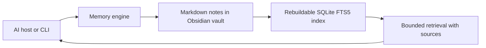

# Architecture

## Data flow

## Source of truth

The vault contains `RecallVault/memories/<uuid>.md`. Each memory has YAML frontmatter, a human-readable title, and Markdown content. Metadata includes project, kind, confirmed/hypothesis/superseded status, dates, source references, tags, and an optional replacement link. Ordinary Obsidian notes remain untouched.

The index lives in `<vault>/.recallvault/index.sqlite`. It stores searchable copies, is ignored by the source repository, and can be deleted and rebuilt from Markdown. Search refreshes it before retrieval so edits and deletions made in Obsidian are reflected. This first version scans managed notes on retrieval; incremental file watching and semantic search are future work.

## Retrieval

Use SQLite FTS5 with Unicode tokenization and ranked keyword matches. Project scope is mandatory. Default retrieval excludes hypotheses and superseded memories. Explicit flags can include them. Enforce result and content budgets and return source paths and reasons for inclusion.

## Writes and lifecycle

Use UUID file names, exclusive temporary files, atomic rename, runtime schema validation, and a process lock for cooperating writers. Detect duplicate normalized content within a project. Supersession writes a new note then links the old one to its replacement, rolling back on handled write failures. Multi-file crash atomicity is not promised; detect partial replacement chains on the next scan. Never automatically infer that conflicting statements supersede each other.

## Agent integration

A stdio MCP server exposes the engine to compatible hosts. The host supplies model intelligence; RecallVault supplies persistence and retrieval. Tools return structured JSON, sources, errors, and explicit mutation annotations. Model-generated extraction and semantic similarity are not part of the initial engine.

## References

- [Obsidian data storage](https://obsidian.md/help/data-storage)
- [Obsidian properties](https://obsidian.md/help/properties)
- [MCP TypeScript SDK](https://ts.sdk.modelcontextprotocol.io/v2/)
- [Node.js 24 SQLite API](https://nodejs.org/docs/latest-v24.x/api/sqlite.html)
